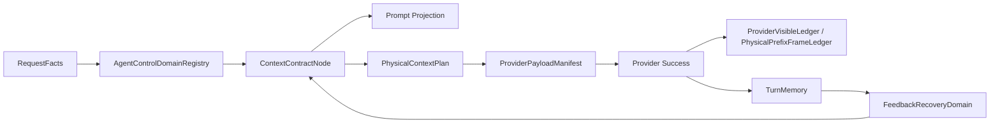

# Agent 控制域架构深化设计书

日期：2026-06-30  
状态：深化设计文档，供审阅；本文不直接改运行代码。  
范围：单 agent 运行控制架构、Agent 控制域、控制信号、反馈路径、Prompt Projection、TurnMemory 热账本边界。  
前置文档：

```text
backend/runtime/context_management/design_docs/semantic_space/semantic_space_time_structure_prompt_design_20260630.md
backend/runtime/context_management/design_docs/semantic_space/mature_agent_semantic_space_time_source_audit_20260630.md
```

## 0. 核心裁决

当前四段式物理上下文结构已经成立：

```text
global_static_prefix
-> provider_visible_context_prefix
-> current_turn_tail
-> never_replay_tail
```

下一步不应该继续增加模型可见前缀，也不应该把更多工程词写进 prompt。真正需要深化的是 Agent 控制层：

```text
Agent Control Domain
-> Control Signal
-> Feedback Route
-> ContextContractNode
-> Prompt Projection
-> PhysicalContextPlan
-> ProviderPayloadManifest
```

讨论中的比喻只用于理解问题，不进入正式代码命名。正式工程翻译如下：

| 用户比喻 | 工程命名 | 含义 |
| --- | --- | --- |
| 身体器官 | `AgentControlDomain` | 一个有明确 agent 行为控制归属的子系统 |
| 神经控制 | `ControlSignal` | 从一个 Agent 控制子系统发出的类型化控制影响 |
| 反馈神经 | `FeedbackRoute` | 观察、失败、恢复、提交结果回到 Agent 控制系统的路线 |
| 心跳节拍 | `turn boundary` | turn 是模型决策和状态提交的节拍 |
| 热账本 | `TurnMemory` | turn 之间的 Present/Future 热状态和恢复句柄 |

本文只把比喻翻译成工程结构，不把比喻写进代码、prompt、字段名或模块名。

最终原则：

```text
Every agent-control node must answer:
  which agent control domain owns me,
  which control signal I emit,
  which agent behavior I may influence,
  which state I may read,
  which state I may write,
  how my observation or failure returns to the next turn.
```

## 1. 技术源审查

### 1.1 现有结构已经具备物理骨架

源码：

```text
backend/runtime/context_management/physical_context_plan.py
backend/runtime/context_management/context_segment_policy.py
backend/runtime/context_management/context_segment_registry.py
```

事实：

- `PhysicalContextPlan` 已定义 `global_static_prefix`、`provider_visible_context_prefix`、`current_turn_tail`、`never_replay_tail`。
- `context_segment_policy_for_spec()` 已能把 segment 分到四个物理 section。
- `context_segment_registry.py` 已有大量 kind、semantic slot、contract slot、repair feedback slot。
- `provider_visible_context_prefix` 与 `global_static_prefix` 是 cache spine。
- `current_turn_tail` 与 `never_replay_tail` 是本轮尾部，不应该被当成本轮 expected cache read。

结论：物理结构不需要再造。新的深化点应落在控制归属和控制路径上。

### 1.2 当前 ContextContractNode 还没有深入到 Agent 控制域

源码：

```text
backend/harness/runtime/context_contract/nodes.py
backend/harness/runtime/context_contract/authority_rules.py
backend/harness/runtime/context_contract/manifest.py
backend/harness/runtime/context_contract/diagnostics.py
```

现有代码真实字段：

```text
semantic_kind
semantic_layer
semantic_time
authority
ttl
visibility
agent_use_contract
commit_policy
replay_policy
cache_tier
```

目标命名不继续新增 `semantic_*` 作为核心字段。原生显式字段使用：

```text
agent_role
control_layer
time_scope
agent_domain
```

问题：

- `authority_rules.py` 仍通过 `kind` 字符串包含 `memory`、`runtime`、`feedback`、`task` 等词来猜现有 `semantic_layer`。
- `ContextContractNode` 还不能表达“这个节点属于哪个 Agent 控制域”。
- 节点还不能表达“这个节点发出什么控制信号”。
- 节点还不能表达“失败、观察、提交后应回流到哪里”。
- `inspection_payload.py` 主要按 layer/time/cache tier 计数，不能诊断控制链路是否接准。

这就是当前最核心的结构短板：分类身份有了，但 Agent 控制还没有深入到每个节点。

### 1.3 TurnMemory 是 Present/Future 热账本

源码：

```text
backend/runtime/turn_memory/turn_memory_models.py
backend/runtime/turn_memory/turn_memory_store.py
backend/runtime/turn_memory/turn_memory_projector.py
backend/runtime/turn_memory/turn_memory_recovery.py
backend/runtime/turn_memory/turn_memory_recovery_context.py
```

TurnMemory 记录：

```text
current_user_message_ref
provider_request_refs
provider_payload_manifest_refs
physical_prefix_frame_id
current_append_hash
assistant_draft_ref
assistant_final_ref
tool_rounds
pending_action_ref
commit_state
frame_promotion_ref
recovery_state
recovery_decision_ref
```

恢复判断：

```text
commit_pending -> retry_commit
frame_pending -> retry_frame_promotion
closed interrupted turn package -> prior_work_memory_context
```

结论：

```text
TurnMemory = Present/Future hot ledger
```

它可以向 `FeedbackRecoveryDomain` 发出恢复、重试、提交、阻塞信号，但不能成为 Past 权威，不能改写 confirmed history。

### 1.4 ProviderPayloadManifest 已经承担隐藏传输和 cache 事实

源码：

```text
backend/runtime/model_gateway/provider_payload.py
```

已存在事实：

- provider messages、tools、tool_call_options、response_format、request_params 都会进入 `ProviderPayloadManifest`。
- transport contract 会计算 `contract_hash`。
- expected cache spine 主要由 `physical_prefix_lane`、`boundary_participation`、`cache_read_expectation`、`lifecycle_state` 决定。
- hidden transport 属于 provider request，不属于 agent-visible memory。

结论：

```text
Provider Transport Contract must stay hidden.
```

Agent 控制层只能引用它的诊断结果，不能把 provider native schema、cache key、request params 投影成模型可见前缀。

### 1.5 成熟 agent 参考结论

已审查本地源码：

```text
D:/AI应用/openai-codex
D:/AI应用/claude-code-nb-main
```

成熟 agent 的共同结构：

| 维度 | Codex / Claude Code 做法 | 本项目对应 |
| --- | --- | --- |
| Self | 稳定系统指令、项目规则、权限/协作规则 | `Operating Contract` |
| Past | transcript history、compaction summary、sealed messages | `Sealed Conversation Timeline` |
| Present | current turn state、pending action、current user input | `Current Task and User Delta` / `Current Runtime Boundary` |
| Future | available tools、pending approval、next action surface | `Action Horizon` |
| HiddenTransport | tools schema、cache_control、prompt_cache_key、thinking config | `Provider Transport Contract` |

关键不变量：

- 模型可见Agent 可读 marker 少。
- 内部 lifecycle/cache fields 多，但隐藏。
- session 历史和 turn 热状态严格分离。
- provider transport 不是 agent memory。
- prompt cache 看真实 request prefix，不看自然语言标签。

因此，本项目不应增加大量可见前缀。应把控制力放进内部 contract。

## 2. 真实问题定义

当前问题不是“前缀名称不够多”，也不是“prompt cache 命中率不够漂亮”。真正问题是：

```text
agent control ownership is not yet executable.
```

也就是：

- 已有物理 lane，但Agent 可读段没有统一的所有权模型。
- 已有 layer/time 分类，但控制信号没有类型化。
- 已有 TurnMemory，但它和 prompt projection、recovery cursor、action horizon 的关系还没有变成明确路由。
- 已有 ProviderPayloadManifest，但它和 Agent 控制节点之间缺少统一引用关系。
- 已有 registry/policy，但 `authority_rules.py` 仍靠字符串启发式补控制契约。

正确终态：

```text
每一个进入 prompt 组装链路的节点，都先被绑定到一个 AgentControlDomain。
每个 AgentControlDomain 只能发出允许的 ControlSignal。
每个 ControlSignal 都有明确目标、agent 行为影响和禁止越权范围。
每个工具观察、失败、恢复、提交结果都有 FeedbackRoute。
Prompt Projection 只把 agent 应执行的控制信息投影出去。
PhysicalContextPlan 只决定物理 lane 和 cache spine。
ProviderPayloadManifest 只记录真实 provider request 和隐藏传输。
TurnMemory 只保存 turn 间热状态和恢复句柄。
```

## 3. 目标概念

### 3.1 AgentControlDomain

`AgentControlDomain` 是有边界的 Agent 控制子系统。它不是 prompt 标题，也不是物理 lane。

它必须声明：

```text
domain_id
purpose
owned_agent_roles
owned_prompt_projection_keys
time_scope
physical_lane_policy
state_read_refs
state_write_policy
allowed_control_signals
forbidden_decisions
feedback_routes
verification_contract
```

一句话定义：

```text
AgentControlDomain owns one bounded agent responsibility and exposes typed control signals.
```

### 3.2 ControlSignal

`ControlSignal` 是一个 Agent 控制域对 agent 行为或下游控制域产生的类型化影响。

它不是命令模型必须怎么想，也不是系统兜底逻辑。它只规定“这段输入可以影响哪类 agent 行为”。

标准信号集合：

| 信号 | 作用 | 典型来源 | 典型目标 |
| --- | --- | --- | --- |
| `orient` | 定位身份、长期行为方式 | IdentityDomain | TaskDomain / OutputDomain |
| `bind_goal` | 绑定当前目标、范围、验收条件 | TaskDomain | ActionHorizonDomain |
| `constrain` | 施加边界、权限、禁止项 | IdentityDomain / RuntimeBoundaryDomain | ActionHorizonDomain |
| `authorize` | 说明当前允许动作 | RuntimeBoundaryDomain | CapabilityDomain / ActionHorizonDomain |
| `recall` | 提供历史或记忆线索 | MemoryDomain / EvidenceTimelineDomain | TaskDomain |
| `anchor_evidence` | 固定证据来源和观察事实 | EvidenceTimelineDomain | OutputDomain |
| `verify` | 要求重新验证高风险记忆或事实 | MemoryDomain / EvidenceTimelineDomain | CapabilityDomain |
| `recover` | 提供恢复、重试、续接路径 | FeedbackRecoveryDomain / TurnMemory | ActionHorizonDomain |
| `commit` | 说明可提交、待提交或提交结果 | OutputDomain / TurnMemory | Ledger / Frame |
| `suppress` | 抑制旧授权、旧边界、过时线索 | RuntimeBoundaryDomain / FeedbackRecoveryDomain | TaskDomain / OutputDomain |
| `handoff` | 将未完成状态交给下一 turn | TurnMemory / OutputDomain | FeedbackRecoveryDomain |
| `present` | 约束最终输出形态 | OutputDomain | user-visible answer |

控制信号必须满足：

- 只能由有权的 domain 发出。
- 必须有目标 domain 或目标行为。
- 必须声明 agent-visible effect。
- 必须声明 forbidden effect。
- 不能把 Past 信号升级成 Present 授权。

### 3.3 FeedbackRoute

`FeedbackRoute` 是观察、失败、恢复、提交结果重新进入 Agent 控制系统的路线。

它必须声明：

```text
source_event
source_authority
target_domain
target_signal
state_write_policy
next_turn_projection
seal_policy
drop_policy
```

一句话定义：

```text
FeedbackRoute carries observations, failures, commits, and recovery handles back into the agent control graph.
```

## 4. 核心不变量

### 4.1 不新增模型可见主前缀

模型可见段仍保持 8 个：

```text
Operating Contract
Capability Surface
Sealed Conversation Timeline
Selected Memory Hints
Current Task and User Delta
Current Runtime Boundary
Feedback and Recovery Cursor
Action Horizon
```

隐藏传输仍保持：

```text
Provider Transport Contract
```

新增的是内部 Agent 控制域和控制信号，不是新增 prompt 标题。

### 4.2 一个节点必须有一个 primary domain

每个 `ContextContractNode` 必须有：

```text
agent_domain
primary_control_signal
```

可以有 secondary signals，但不能没有 primary domain。

### 4.3 时间域不能越权

```text
Self -> 可约束长期行为，不能携带当前错误和当前工具结果。
Past -> 可提供历史事实，不能提供当前授权。
Present -> 可说明当前事实和边界，不能进入稳定身份。
Future -> 可给行动空间，不能替 agent 做最终选择。
HiddenTransport -> 只影响 provider request，不能成为 agent memory。
```

### 4.4 历史和热账本分离

```text
Provider-visible ledger / physical prefix frame = Past authority
TurnMemory = Present/Future hot ledger
```

TurnMemory 可以恢复 pending action、commit、frame promotion、assistant draft，但不能修改 sealed history。

### 4.5 Provider transport 不能投影成 agent memory

以下内容只存在于 hidden transport / manifest / diagnostics：

```text
tools sidecar
tool_choice
response_format
request_params
cache_control
prompt_cache_key
transport_contract_hash
provider_serialized_hash
```

`Capability Surface` 只能写能力摘要、使用边界、关键参数概念和 `schema_ref`。

## 5. Agent 控制域架构

### 5.1 总体结构



### 5.2 控制域清单

| AgentControlDomain | 时间域 | 模型可见投影 | 物理 lane | 主信号 | 权威来源 |
| --- | --- | --- | --- | --- | --- |
| `IdentityDomain` | Self | `Operating Contract` | `global_static_prefix` | `orient`, `constrain` | prompt library / project instructions |
| `TaskDomain` | Present | `Current Task and User Delta` | `current_turn_tail` | `bind_goal` | RequestFacts / user input |
| `CapabilityDomain` | Self / Future | `Capability Surface` | `global_static_prefix` + hidden tool sidecar | `authorize`, `verify` | tool catalog / action schema / provider tool manifest |
| `MemoryDomain` | Past | `Selected Memory Hints` | `provider_visible_context_prefix` or `current_turn_tail` | `recall`, `verify` | memory system / selected memory refs |
| `EvidenceTimelineDomain` | Past | `Sealed Conversation Timeline` | `provider_visible_context_prefix` | `recall`, `anchor_evidence` | provider-visible ledger / physical prefix frame |
| `RuntimeBoundaryDomain` | Present | `Current Runtime Boundary` | `never_replay_tail` | `constrain`, `authorize`, `suppress` | runtime delta / permission boundary |
| `FeedbackRecoveryDomain` | Present / Future | `Feedback and Recovery Cursor` | `never_replay_tail` | `recover`, `suppress`, `handoff` | TurnMemory / recovery boundary / tool failures |
| `ActionHorizonDomain` | Future | `Action Horizon` | `never_replay_tail` | `authorize`, `bind_goal` | turn operating contract / runtime action surface |
| `OutputDomain` | Present / Future | no new title; affects final answer contract | `never_replay_tail` for current contract, ledger after success | `present`, `commit` | output boundary / commit controller |
| `TransportDomain` | HiddenTransport | hidden only | provider sidecar / request params | hidden `bind_transport` | ProviderPayloadManifest |

注意：

- `OutputDomain` 不新增模型可见主标题。它通过 `Current Runtime Boundary`、`Feedback and Recovery Cursor`、`Action Horizon` 的 contract 影响最终输出和 commit。
- `TransportDomain` 不进入 agent-visible prompt。

## 6. 每个控制域的职责边界

### 6.1 IdentityDomain

职责：

- 维护 agent 的长期身份、协作规则、项目约束、稳定行为原则。
- 给 Task / Output 提供长期方向。

读取：

```text
prompt_library
AGENTS.md / project instructions
stable permission principles
stable collaboration rules
```

写入：

```text
none during normal turn
```

允许信号：

```text
orient
constrain
```

禁止决策：

- 不解释本轮用户真实意图。
- 不决定工具调用。
- 不持有当前工具结果。
- 不持有当前错误、当前恢复状态。

Agent prompt effect：

```text
你以这里的长期规则作为稳定行为边界。
这里不是本轮新增任务，也不能覆盖用户最新话语。
```

失败路径：

- 如果 Identity 与 Present 冲突，`RuntimeBoundaryDomain` 发出 `suppress`，使旧规则只保留合法长期约束，不覆盖当前边界。

### 6.2 TaskDomain

职责：

- 绑定当前用户最新目标、范围、材料、验收条件。
- 区分旧计划、旧请求与本轮最新 delta。

读取：

```text
RequestFacts
current_user_message_ref
attachments_ref
editor_context_ref
active_steer_refs
```

写入：

```text
current_turn_tail candidate
TurnMemory.current_user_message_ref
```

允许信号：

```text
bind_goal
verify
```

禁止决策：

- 不封存历史。
- 不修改 provider-visible ledger。
- 不把旧计划当成本轮确认。

Agent prompt effect：

```text
你先以这里识别用户现在要什么。
如果这里与旧历史冲突，以这里和当前运行边界为准。
```

失败路径：

- 缺关键用户输入时，向 `ActionHorizonDomain` 发出 `ask_user` 候选。
- 目标与边界冲突时，交给 `RuntimeBoundaryDomain` 约束。

### 6.3 CapabilityDomain

职责：

- 给 agent 一个稳定、简明的能力面。
- 把 provider native schema 保留在 hidden transport。
- 把工具可用性、参数概念、边界、schema_ref 作为能力约束信息。

读取：

```text
tool_catalog_manifest
action_schema_manifest
provider tool protocol
current permission boundary
```

写入：

```text
Capability Surface prompt projection
ProviderPayloadManifest tools segment
```

允许信号：

```text
authorize
verify
```

禁止决策：

- 不替 agent 选择工具。
- 不把完整 provider native schema 写进 message prefix。
- 不把 tool schema 变化伪装成 memory。

Agent prompt effect：

```text
你可以根据任务需要选择这些能力。
工具返回是事实观察，不是最终结论。
```

失败路径：

- tool unavailable / schema drift 进入 `FeedbackRecoveryDomain`。
- cache-sensitive tool schema drift 进入 `TransportDomain` diagnostics，不进入 agent memory。

### 6.4 MemoryDomain

职责：

- 提供用户偏好、项目背景、长期线索。
- 明确记忆不是证据。

读取：

```text
memory store
selected memory refs
task state replay refs
```

写入：

```text
Selected Memory Hints
current_turn_tail memory candidate
provider_visible_context_prefix after seal if confirmed
```

允许信号：

```text
recall
verify
```

禁止决策：

- 不给出当前事实裁决。
- 不覆盖用户最新话语。
- 不替代文件、日志、工具观察。

Agent prompt effect：

```text
你可以把这里作为线索。
涉及精确判断、代码修改、时间敏感结论或最终验收时，必须用当前证据验证。
```

失败路径：

- 记忆与证据冲突时，`EvidenceTimelineDomain` 发出 `anchor_evidence`，`MemoryDomain` 降级为 rejected hint。

### 6.5 EvidenceTimelineDomain

职责：

- 管理已发生、已观察、已封存的历史事实。
- 提供 oldest-to-newest 的历史阅读顺序。

读取：

```text
provider-visible ledger
physical prefix frame
sealed tool observations
sealed assistant/user messages
```

写入：

```text
provider_visible_context_prefix
sealed conversation timeline
```

允许信号：

```text
recall
anchor_evidence
suppress
```

禁止决策：

- 不把旧 runtime boundary 当成本轮授权。
- 不重排 confirmed old context。
- 不在 replay 时重新解释历史。

Agent prompt effect：

```text
这里说明之前已经发生什么。
旧用户请求不是本轮新增指令。
旧运行边界不是本轮授权。
```

失败路径：

- edit-resend / rollback 破坏基线时，重置 prefix baseline，由 `PhysicalPrefixFrameLedger` 重新建立 confirmed replay。

### 6.6 RuntimeBoundaryDomain

职责：

- 表达本轮权限、运行状态、写入边界、预算、恢复状态。
- 抑制旧授权和旧边界。

读取：

```text
runtime envelope
permission boundary
turn operating contract
request facts
recoverable work candidate
```

写入：

```text
Current Runtime Boundary
never_replay_tail
```

允许信号：

```text
constrain
authorize
suppress
```

禁止决策：

- 不作为历史封存。
- 不进入 stable prefix。
- 不替 agent 选择下一步。

Agent prompt effect：

```text
这些边界只对本轮有效。
旧历史里的不同权限或状态只代表过去。
```

失败路径：

- 权限不足时交给 `ActionHorizonDomain` 生成 ask_user/block 候选。
- 运行状态不一致时交给 `FeedbackRecoveryDomain` 生成 recovery signal。

### 6.7 FeedbackRecoveryDomain

职责：

- 接收工具失败、provider failure、stream interruption、commit pending、frame pending、TurnMemory recovery。
- 给 agent 下一步恢复方向，但不重复失败动作。

读取：

```text
TurnMemory.recovery_context
tool observations
runtime recovery boundary
commit receipts
frame promotion receipts
```

写入：

```text
Feedback and Recovery Cursor
never_replay_tail
TurnMemory recovery fields
```

允许信号：

```text
recover
suppress
handoff
commit
```

禁止决策：

- 不重跑已成功提交的动作。
- 不从 UI replay 猜测未提交事实。
- 不把恢复 cursor 封存为长期记忆。

Agent prompt effect：

```text
如果反馈说明某动作失败，不要原样重复失败动作。
你需要改变参数、路径、工具、计划，或者说明真实阻塞。
```

失败路径：

- recoverable -> `ActionHorizonDomain` 给出 retry / resume / ask_user。
- unrecoverable -> `OutputDomain` 输出真实阻塞。

### 6.8 ActionHorizonDomain

职责：

- 汇总当前可选行动空间。
- 把目标、能力、边界、反馈整合为最小充分下一步。

读取：

```text
TaskDomain signals
CapabilityDomain signals
RuntimeBoundaryDomain signals
FeedbackRecoveryDomain signals
```

写入：

```text
Action Horizon
never_replay_tail
```

允许信号：

```text
authorize
bind_goal
recover
present
```

禁止决策：

- 不替 agent 固定唯一动作，除非当前边界已经唯一。
- 不为了使用工具而使用工具。
- 不把旧计划作为当前行动优先级。

Agent prompt effect：

```text
你选择一个最小充分行动。
事实足够时直接回应；需要事实时请求工具；需要用户裁决时询问；无法合法推进时说明阻塞。
```

失败路径：

- 如果所有 action 都被 boundary suppress，向 `OutputDomain` 发出 block presentation。

### 6.9 OutputDomain

职责：

- 约束最终输出是否可提交、如何提交、是否需要阻塞说明。
- 连接 assistant draft/final、commit controller、TurnMemory、ledger。

读取：

```text
Output boundary
assistant draft/final refs
TurnMemory commit_state
EvidenceTimelineDomain anchor_evidence signals
```

写入：

```text
assistant_final_ref
assistant_final_sha256
commit receipt
session_commit_ref
frame_promotion_ref
```

允许信号：

```text
present
commit
handoff
```

禁止决策：

- 不绕过证据边界提交。
- 不用自造结果应付验收。
- 不提交未被当前 boundary 允许的副作用。

Agent prompt effect：

```text
你的最终回答必须只陈述真实完成的工作、真实观察到的结果、真实阻塞和可继续条件。
```

失败路径：

- commit pending -> TurnMemory `retry_commit`。
- frame pending -> TurnMemory `retry_frame_promotion`。
- draft only -> TurnMemory `recover_from_checkpoint`。

### 6.10 TransportDomain

职责：

- 管理 provider request 的隐藏传输契约。
- 诊断 cache family、tool schema、request params、provider serialized hash。

读取：

```text
ProviderPayloadManifest
tool sidecar
request params
transport_contract_hash
provider cache response
```

写入：

```text
ProviderPayloadManifest.transport_contract
ProviderPayloadManifest.cache_boundary
provider_cache_bus diagnostics
```

允许信号：

```text
hidden bind_transport
hidden cache_diagnose
```

禁止决策：

- 不进入 agent-visible prompt。
- 不进入 sealed conversation timeline。
- 不生成 memory hint。

Agent prompt effect：

```text
none
```

失败路径：

- cache drift -> diagnostics / inspector。
- provider request invalid -> FeedbackRecoveryDomain receives recoverable transport failure, but transport details remain hidden unless needed as high-level error fact.

## 7. 控制信号矩阵

| Signal | Source Organ | Target Organ | Agent-visible effect | Forbidden effect |
| --- | --- | --- | --- | --- |
| `orient` | IdentityDomain | TaskDomain / OutputDomain | 稳定身份和长期协作方式 | 覆盖当前用户请求 |
| `bind_goal` | TaskDomain | ActionHorizonDomain | 明确当前目标、范围、验收条件 | 复活旧计划 |
| `constrain` | IdentityDomain / RuntimeBoundaryDomain | ActionHorizonDomain | 限制权限、写入范围、输出边界 | 替 agent 决定工具 |
| `authorize` | RuntimeBoundaryDomain / CapabilityDomain | ActionHorizonDomain | 说明当前合法动作和能力 | 绕过权限 |
| `recall` | MemoryDomain / EvidenceTimelineDomain | TaskDomain | 提供历史线索和上下文理解 | 当作当前事实裁决 |
| `anchor_evidence` | EvidenceTimelineDomain | OutputDomain | 支撑最终回答和验收判断 | 替代当前必须重验的事实 |
| `verify` | MemoryDomain / TaskDomain | CapabilityDomain | 触发读取、搜索、运行等观察动作 | 用记忆直接下结论 |
| `recover` | FeedbackRecoveryDomain | ActionHorizonDomain | 选择恢复、重试、续接或阻塞 | 原样重复失败动作 |
| `commit` | OutputDomain / TurnMemory | Ledger / Frame | 提交或重试提交已完成结果 | 提交未完成结果 |
| `suppress` | RuntimeBoundaryDomain / EvidenceTimelineDomain | TaskDomain / OutputDomain | 抑制旧授权、旧边界、冲突线索 | 删除真实历史 |
| `handoff` | TurnMemory / OutputDomain | FeedbackRecoveryDomain | 把未完成热状态交给下一 turn | 让 TurnMemory 改写 Past |
| `present` | OutputDomain | user-visible answer | 约束最终输出内容 | 伪造验证或成果 |

## 8. 反馈路径

### 8.1 工具观察路径

```text
Tool observation
-> EvidenceTimelineDomain receives anchor_evidence candidate
-> current_turn_tail in this turn
-> provider success
-> provider_visible_context_prefix in next turn
-> OutputDomain may cite as sealed evidence
```

规则：

- 工具观察本轮是 current append，不期待本轮 prefix cache hit。
- provider success 后才能成为下一轮 Past。
- observation error 进入 `FeedbackRecoveryDomain`，不是 evidence anchor。

### 8.2 工具失败路径

```text
Tool failure / denial / invalid args
-> FeedbackRecoveryDomain emits recover or suppress
-> ActionHorizonDomain picks retry with changed parameters, ask_user, or block
```

规则：

- 不允许原样重复失败工具调用。
- 失败事实可以投影给 agent，但 provider/internal transport details 不能泄漏成 memory。

### 8.3 输出提交路径

```text
assistant draft
-> TurnMemory.assistant_draft_ref
assistant final
-> OutputDomain present
-> TurnMemory.assistant_final_ref
-> commit controller
-> session commit / frame promotion
-> provider_visible ledger or physical prefix frame
```

规则：

- `commit_pending` 只能重试 commit。
- `frame_pending` 只能重试 frame promotion。
- 不应重跑模型来制造第二份 final。

### 8.4 中断闭合到新 turn 记忆路径

```text
runtime interruption
-> SingleAgentHost closes TurnMemory as terminal interrupted memory package
-> build_prior_work_memory_context()
-> compiler projects read-only prior work memory
-> next turn agent makes a fresh decision
```

规则：

- 中断闭合来源是 TurnMemory 生命周期，不是 UI 文本。
- prior work memory 是下一 turn 的只读上下文，不是旧 turn 恢复动作。

### 8.5 缓存诊断路径

```text
ProviderPayloadManifest
-> provider_cache_bus
-> expected prefix coverage
-> inspector / diagnostics
```

规则：

- cache 诊断不应该成为 agent-visible prompt。
- 健康主指标是 expected prefix 是否完整命中，不是总 hit rate。
- `provider_under_read_tokens == 0` 才说明 expected prefix 读取健康。

## 9. ContextContractNode 原生显式字段

当前 `ContextContractNode` 不需要推翻，应直接补齐原生显式字段。

新增字段：

```text
agent_domain: str
primary_control_signal: str
control_signals: tuple[str, ...]
decision_scope: str
state_read_refs: tuple[str, ...]
state_write_policy: str
feedback_routes: tuple[str, ...]
verification_contract: str
prompt_projection_key: str
physical_lane: str
cache_expectation: str
lifecycle_reason: str
```

字段含义：

| 字段 | 含义 |
| --- | --- |
| `agent_domain` | 控制归属，不由字符串猜 |
| `primary_control_signal` | 该节点最主要的控制作用 |
| `control_signals` | 附加控制信号 |
| `decision_scope` | 该节点可影响 agent 哪类行为 |
| `state_read_refs` | 可读取的状态引用 |
| `state_write_policy` | 可写入哪里，或明确不可写 |
| `feedback_routes` | 观察/失败/提交后回流路径 |
| `verification_contract` | agent 使用前是否必须验证 |
| `prompt_projection_key` | 投影到 8 个 agent-visible 段中的哪一个，hidden transport 为空 |
| `physical_lane` | 四段式物理 lane |
| `cache_expectation` | `expected_read` / `normal_miss` / `excluded` |
| `lifecycle_reason` | 为什么 stable/current/hidden |

### 9.1 Memory hint 示例

```json
{
  "agent_role": "memory_hint",
  "control_layer": "L4",
  "time_scope": "Past",
  "agent_domain": "MemoryDomain",
  "primary_control_signal": "recall",
  "control_signals": ["recall", "verify"],
  "visibility": "agent_visible",
  "prompt_projection_key": "Selected Memory Hints",
  "physical_lane": "provider_visible_context_prefix",
  "cache_expectation": "expected_read",
  "decision_scope": "may guide interpretation; must not decide current facts",
  "state_read_refs": ["memory:selected_refs"],
  "state_write_policy": "no direct write; selected memory candidate may seal after provider success",
  "feedback_routes": ["memory_conflict_to_evidence_anchor", "used_memory_to_output_verification"],
  "verification_contract": "Must verify against current evidence before precise conclusion."
}
```

### 9.2 Runtime boundary 示例

```json
{
  "agent_role": "runtime_boundary",
  "control_layer": "L6",
  "time_scope": "Present",
  "agent_domain": "RuntimeBoundaryDomain",
  "primary_control_signal": "constrain",
  "control_signals": ["constrain", "authorize", "suppress"],
  "visibility": "agent_visible",
  "prompt_projection_key": "Current Runtime Boundary",
  "physical_lane": "never_replay_tail",
  "cache_expectation": "excluded",
  "decision_scope": "current-turn permission and execution boundary",
  "state_read_refs": ["runtime_envelope", "permission_boundary"],
  "state_write_policy": "never commit as current authority; may be recorded only as historical note",
  "feedback_routes": ["boundary_conflict_to_action_horizon"],
  "verification_contract": "Current boundary overrides old runtime boundary."
}
```

### 9.3 Provider transport 示例

```json
{
  "agent_role": "provider_transport",
  "control_layer": "L8",
  "time_scope": "HiddenTransport",
  "agent_domain": "TransportDomain",
  "primary_control_signal": "bind_transport",
  "control_signals": ["bind_transport", "cache_diagnose"],
  "visibility": "provider_transport",
  "prompt_projection_key": "",
  "physical_lane": "",
  "cache_expectation": "hidden_family_selector",
  "decision_scope": "provider request assembly and cache diagnostics only",
  "state_read_refs": ["ProviderPayloadManifest.transport_contract"],
  "state_write_policy": "write manifest diagnostics only; never commit to history",
  "feedback_routes": ["transport_failure_to_feedback_recovery"],
  "verification_contract": "Must not project provider params or native schema into agent memory."
}
```

## 10. Prompt Projection 规则

### 10.1 投影边界

Prompt Projection 只做一件事：

```text
把 ContextContractNode 中 agent-visible 的 Agent 控制契约投影成 agent 能直接执行的文本。
```

它禁止：

- 暴露 `agent_domain`、`cache_expectation`、`physical_lane` 等内部字段为主标题。
- 暴露 provider native schema、cache hash、transport params。
- 把 `volatile`、`dynamic_tail`、`context_append` 写给模型看。

### 10.2 八段投影与控制域关系

| Prompt 段 | 主要 domain | 允许信号 |
| --- | --- | --- |
| `Operating Contract` | IdentityDomain | `orient`, `constrain` |
| `Capability Surface` | CapabilityDomain | `authorize`, `verify` |
| `Sealed Conversation Timeline` | EvidenceTimelineDomain | `recall`, `anchor_evidence`, `suppress` |
| `Selected Memory Hints` | MemoryDomain | `recall`, `verify` |
| `Current Task and User Delta` | TaskDomain | `bind_goal`, `verify` |
| `Current Runtime Boundary` | RuntimeBoundaryDomain | `constrain`, `authorize`, `suppress` |
| `Feedback and Recovery Cursor` | FeedbackRecoveryDomain | `recover`, `handoff`, `suppress` |
| `Action Horizon` | ActionHorizonDomain | `authorize`, `bind_goal`, `recover`, `present` |

### 10.3 可直接发送给 agent 的控制文案

以下文案是“控制域条款”，可被合并到既有 8 段模板中。它们不是开发说明。

#### Operating Contract 控制条款

```text
你以本段作为长期行为边界。
本段不包含本轮新增任务，也不包含当前工具结果。
如果本段与当前用户最新话语或当前运行边界冲突，以当前用户最新话语和当前运行边界为准。
```

#### Capability Surface 控制条款

```text
你可以根据当前目标选择这里列出的能力。
能力说明只表示可用行动空间，不替你决定必须调用哪个工具。
完整 provider 工具 schema 不在本段中；你只需要依据当前可见能力、参数概念和边界提出合法行动。
```

#### Sealed Conversation Timeline 控制条款

```text
这里是已经发生并封存的历史。
它可以帮助你理解过去，但旧请求不是本轮新增指令，旧运行边界不是本轮授权。
如果历史事实与当前证据冲突，你需要优先处理当前证据并说明冲突。
```

#### Selected Memory Hints 控制条款

```text
这里是记忆线索，不是证据。
你可以用它理解用户偏好、项目背景或审查方向。
涉及精确结论、代码修改、时间敏感判断或最终验收时，你必须用当前证据验证。
```

#### Current Task and User Delta 控制条款

```text
这里是本轮最新用户目标和新增事实。
你需要先判断用户现在真正要求什么。
如果本段与旧历史或旧计划冲突，以本段为当前任务入口。
```

#### Current Runtime Boundary 控制条款

```text
这里的权限、边界、预算和运行状态只对本轮有效。
你只能基于这里列出的当前边界提交行动。
旧历史中的权限、边界或恢复要求只代表过去，不能作为本轮授权。
```

#### Feedback and Recovery Cursor 控制条款

```text
这里说明上一动作或当前运行状态刚刚发生了什么。
如果反馈说明动作失败，不要原样重复失败动作。
你需要改变参数、路径、范围、工具、计划，或者说明真实阻塞。
```

#### Action Horizon 控制条款

```text
这里是当前可以选择的下一步行动空间。
你需要选择一个最小充分行动。
事实足够时直接回应；需要更多事实时请求最小必要工具行动；需要用户裁决时提出清楚问题；无法合法推进时说明阻塞。
```

## 11. 目标权威链路

目标链路：

```text
RequestFacts
-> ContextSegmentRegistry explicit agent-control declarations
-> ContextSegmentPolicy physical/cache policy
-> AgentControlDomainRegistry
-> ContextContractManifest
-> PromptProjection
-> PhysicalContextPlan
-> ProviderPayloadManifest
-> Provider request bytes
-> Provider success/failure
-> ProviderVisibleLedger / PhysicalPrefixFrameLedger
-> TurnMemory hot handoff/recovery
-> FeedbackRecoveryDomain
```

权威分工：

| 层 | 可以做 | 禁止做 |
| --- | --- | --- |
| RequestFacts | 捕获用户输入、附件、编辑器事实 | 改写用户目标 |
| ContextSegmentRegistry | 声明 kind 的 Agent 控制域、agent role、默认 slot | 决定 provider bytes |
| ContextSegmentPolicy | 决定物理 section、commit/replay/cache policy | 生成长 prompt |
| AgentControlDomainRegistry | 声明 domain 的信号、读写、反馈路由 | 读取 provider response |
| ContextContractManifest | 生成节点和边，诊断 Agent 控制链 | 重排 confirmed history |
| PromptProjection | 投影 8 个 agent-visible 段 | 暴露 hidden transport |
| PhysicalContextPlan | 分配四段 physical lane | 解释任务目标 |
| ProviderPayloadManifest | 记录真实 provider request 和 cache boundary | 替 registry 猜控制归属 |
| Ledger / Frame | 封存 provider success 后的历史 | 修改已 confirmed old context |
| TurnMemory | 保存 turn 热状态、恢复和提交句柄 | 替代 Past ledger |

## 12. 代码结构与连线标准化

本次深化设计的实施要求不是“多加字段”，而是让每一条代码链路都标准化、规范化、可追踪。

这里的“线”指任何跨模块连接：

```text
registry declaration -> policy
policy -> context contract node
context contract node -> prompt projection
context contract node -> physical lane
physical lane -> provider payload segment
provider result -> ledger/frame
provider result -> TurnMemory
TurnMemory -> recovery cursor
diagnostics -> inspector
```

每一条线都必须有标准连接契约：

```text
source
target
payload_schema
authority
lifecycle
cache_expectation
state_read_policy
state_write_policy
failure_route
diagnostics_key
```

### 12.1 标准连接契约

| 字段 | 必填 | 含义 |
| --- | --- | --- |
| `source` | 是 | 连接来源模块或数据结构 |
| `target` | 是 | 连接目标模块或数据结构 |
| `payload_schema` | 是 | 传输数据的最小结构 |
| `authority` | 是 | 哪一层有权解释这条线 |
| `lifecycle` | 是 | stable / append_only / current_turn / provider_request |
| `cache_expectation` | 是 | expected_read / normal_miss / excluded / hidden |
| `state_read_policy` | 是 | 可以读取哪些状态 |
| `state_write_policy` | 是 | 可以写入哪些状态 |
| `failure_route` | 是 | 失败后进入哪个 feedback route |
| `diagnostics_key` | 是 | inspector / log 中如何定位 |

标准示例：

```json
{
  "source": "ContextContractNode",
  "target": "PhysicalContextPlan",
  "payload_schema": "context_contract_node_ref + physical_lane + cache_expectation",
  "authority": "runtime.context_management.physical_context_plan",
  "lifecycle": "current_turn",
  "cache_expectation": "normal_miss",
  "state_read_policy": "read agent_domain, time_scope, commit_policy",
  "state_write_policy": "write physical lane metadata only",
  "failure_route": "physical_lane_conflict_to_context_contract_diagnostics",
  "diagnostics_key": "context_physical_assembly_index"
}
```

### 12.2 模块边界

代码结构必须保持单向分层：

```text
context_segment_registry
-> context_segment_policy
-> agent_control_domains
-> context_contract_manifest
-> prompt_projection
-> physical_context_plan
-> provider_payload_manifest
-> ledger / turn_memory
-> feedback_projection
```

允许引用方向：

| 模块 | 可以读取 | 不允许读取 |
| --- | --- | --- |
| `context_segment_registry` | 静态声明 | runtime state / provider result |
| `context_segment_policy` | registry declaration / spec metadata | provider response / TurnMemory |
| `agent_control_domains` | registry/policy 声明 | provider bytes / UI state |
| `context_contract_manifest` | message specs / policy / domain registry | ledger mutation |
| `prompt_projection` | contract nodes | provider native schema / cache hash |
| `physical_context_plan` | policy / metadata | agent prompt 文案 |
| `provider_payload_manifest` | provider messages / bindings / transport params | 重新解释任务目标 |
| `ledger/frame` | provider success material | 当前 turn 授权 |
| `TurnMemory` | turn hot state / refs / commit state | confirmed history mutation |
| `feedback_projection` | TurnMemory / failures / receipts | stable identity mutation |

禁止反向依赖：

```text
provider_payload_manifest -> context_segment_registry decision rewrite
TurnMemory -> provider_visible_ledger mutation
prompt_projection -> physical lane decision
frontend inspector -> cache health decision
diagnostics -> runtime authority override
```

### 12.3 命名标准

内部字段命名必须表达真实工程含义，不使用比喻命名。

允许：

```text
agent_domain
control_signal
feedback_route
physical_lane
cache_expectation
state_write_policy
provider_payload_segment_ref
turn_memory_recovery_ref
```

禁止：

```text
nerve
organ_heartbeat
brain_signal
body_path
magic_context
smart_cache
maybe_memory
```

模型可见标题继续只允许：

```text
Operating Contract
Capability Surface
Sealed Conversation Timeline
Selected Memory Hints
Current Task and User Delta
Current Runtime Boundary
Feedback and Recovery Cursor
Action Horizon
```

### 12.4 连线类型

跨模块连接只允许这些类型：

| 类型 | 用途 | 示例 |
| --- | --- | --- |
| `ownership_edge` | 声明控制归属 | kind -> AgentControlDomain |
| `projection_edge` | 投影到 prompt 段 | node -> prompt_projection_key |
| `physical_edge` | 分配物理 lane | node -> physical_lane |
| `transport_edge` | 绑定 provider segment | node -> provider_payload_segment |
| `feedback_edge` | 失败/观察/恢复回流 | tool failure -> FeedbackRecoveryDomain |
| `commit_edge` | 成功提交/封存 | provider success -> ledger/frame |
| `diagnostic_edge` | inspector/log 定位 | cache miss -> agent domain |

任何新增连接类型都必须先写进 `agent_control_domains.py` 或同级 contract 模块，不允许在业务代码里临时字符串拼接。

### 12.5 旧链路清理规则

实施时不能以兼容为理由保留旧链路作为运行分支。

允许：

```text
old heuristic result -> read-only diagnostics comparison
```

禁止：

```text
old heuristic result -> runtime routing
old prompt title path -> model-visible prefix
old cache label path -> health decision
old UI replay path -> recovery authority
```

清理判断：

```text
如果一条旧线已经不再是目标权威链路的一部分，
它只能临时作为只读对照日志存在，
不能继续参与 prompt projection、physical lane、cache health、recovery decision。
切换完成后删除。
```

### 12.6 标准化完成标准

实施完成后，每个 Agent 控制节点都能在 inspector 中回答：

```text
我来自哪里？
我属于哪个 AgentControlDomain？
我发出什么 ControlSignal？
我投影到哪个 agent-visible 段？
我进入哪个 physical lane？
我是否 expected cache read？
我成功后写入哪里？
我失败后进入哪个 FeedbackRoute？
谁有权解释我？
```

如果某个节点无法回答以上问题，它不能进入正式 prompt 组装链路，只能进入 diagnostics。

## 13. 实施计划

这是后续执行计划。由于会影响 runtime / context / prompt / memory 主链路，执行前应由用户确认。

### Phase 1：新增显式 AgentControlDomainRegistry 与连接契约

目标：

```text
让 `agent_domain` 成为内部标准身份，并让跨模块连接有标准契约，不再从 kind 字符串猜。
```

涉及文件：

```text
backend/harness/runtime/context_contract/nodes.py
backend/harness/runtime/context_contract/agent_control_domains.py
backend/harness/runtime/context_contract/connection_contracts.py
backend/runtime/context_management/context_segment_registry.py
backend/runtime/context_management/context_segment_policy.py
```

动作：

- 新增 `agent_control_domains.py`，声明 domain、allowed signals、feedback routes。
- 新增 `connection_contracts.py`，声明标准 edge type、payload schema、authority、failure route。
- 扩展 `ContextSegmentKindDeclaration`，增加：

```text
agent_role
time_scope
agent_domain
primary_control_signal
prompt_projection_key
verification_contract
```

- 对现有重要 kind 做显式映射。
- `ContextContractNode` 增加原生显式字段。

完成标准：

- `ContextContractNode` 不再只有 layer/time，还能说明 domain/signal/feedback route。
- 每条跨模块连接都有标准 `connection_contract`。
- registry 中的主要 context kind 都有显式 domain。
- unknown kind 产生 `agent_control_contract_missing` 诊断，不默默猜成某一层。

### Phase 2：替换 authority_rules.py 启发式分类

目标：

```text
authority_rules.py 从显式 registry/policy/metadata 读取 Agent 控制契约。
```

涉及文件：

```text
backend/harness/runtime/context_contract/authority_rules.py
backend/harness/runtime/context_contract/diagnostics.py
backend/harness/runtime/context_contract/inspection_payload.py
```

动作：

- `classify_context_spec()` 优先读取 explicit fields。
- 移除主要字符串猜测链路。
- 缺失 explicit contract 时写诊断：

```text
agent_control_contract_missing
agent_domain_missing
control_signal_missing
feedback_route_missing
```

- diagnostics 增加 domain/signal/route 统计。

完成标准：

- 控制分类不再依赖 `"memory" in kind`、`"runtime" in kind` 等主逻辑。
- inspector 能展示每个 node 的 domain、signal、physical lane、cache expectation。

### Phase 3：Prompt Projection 与 8 段模板对齐

目标：

```text
Prompt Projection 由 agent domain contract 驱动，但模型可见段名仍只有 8 个。
```

涉及文件：

```text
backend/harness/runtime/compiler.py
backend/prompt_library/rules.py
backend/prompt_library/packs.py
backend/harness/runtime/dynamic_context/*
```

动作：

- 建立 `prompt_projection_key -> template` 映射。
- 将本文第 10 节控制条款纳入对应段。
- 禁止把 `dynamic_tail`、`context_append`、`volatile` 等内部词作为模型可见主标题。
- L8 `TransportDomain` 不参与 prompt projection。

完成标准：

- agent-visible prompt 只出现 8 个标准段名。
- provider transport 不进入 message prefix。
- 每个 agent-visible node 都有可直接给 agent 执行的 `agent_use_contract`。

### Phase 4：TurnMemory 反馈路径接入

目标：

```text
TurnMemory 只作为 Present/Future 热账本，向 FeedbackRecoveryDomain 发信号。
```

涉及文件：

```text
backend/runtime/turn_memory/turn_memory_projector.py
backend/runtime/turn_memory/turn_memory_recovery.py
backend/runtime/turn_memory/turn_memory_recovery_context.py
backend/harness/runtime/dynamic_context/history_projector.py
backend/harness/entrypoint/runtime_facade.py
```

动作：

- 将 `build_turn_memory_recovery_context()` 输出绑定到 `FeedbackRecoveryDomain`。
- 将 recovery decision 映射为 `recover` / `commit` / `handoff` signal。
- 明确 `commit_pending` 和 `frame_pending` 只能重试对应提交动作。
- 恢复 cursor 进入 `never_replay_tail`。

完成标准：

- TurnMemory recovery 不被投影成 Past。
- recovery cursor 不封存为当前授权。
- interrupted turn 能通过热账本续接，而不是从 UI replay 猜事实。

### Phase 5：ProviderPayloadManifest 与 Agent 控制节点互链

目标：

```text
Agent 控制节点能引用真实 provider payload segment，provider manifest 能回指 agent-control node。
```

涉及文件：

```text
backend/runtime/model_gateway/provider_payload.py
backend/runtime/context_management/context_prefix_identity.py
backend/runtime/prompt_accounting/provider_cache_bus.py
backend/harness/runtime/context_contract/manifest.py
```

动作：

- 在 ProviderPayloadSegment metadata 中加入 `context_contract_node_ref`。
- 在 ContextContractNode refs 中加入 `provider_payload_segment_ref`。
- Hidden transport 只显示在 manifest / diagnostics。
- cache diagnostics 输出 first missing expected prefix identity 与 agent domain。

完成标准：

- cache anomaly 可以定位到 physical lane + agent domain + provider segment。
- 总 hit rate 不作为健康主裁决。

### Phase 6：清理旧链路、重复术语和非标准连线

目标：

```text
删除或降级旧的启发式、旧标签可见路径、重复诊断口径和非标准跨层直连。
```

涉及范围：

```text
backend/harness/runtime/context_contract
backend/harness/runtime/compiler.py
backend/runtime/context_management
backend/runtime/model_gateway
frontend cache/context inspector components
```

动作：

- 移除作为主逻辑的字符串启发式分类。
- 清理把内部 lane/cache label 投影给模型看的路径。
- 清理绕过 `connection_contracts.py` 的跨层直连。
- 前端只展示内部字段为 diagnostics，不把它们当 prompt 标题。
- 不保留旧链路作为兼容兜底；切换前可保留只读诊断对照，切换后删除运行分支。

完成标准：

- 只有一条 Agent 控制权威链。
- 每条线都有标准 source/target/payload/authority/failure route。
- 只有一套 cache 健康口径。
- 只有一套 prompt projection 段名。

## 14. 文件级执行清单

| 文件 | 目标改动 |
| --- | --- |
| `backend/harness/runtime/context_contract/nodes.py` | `ContextContractNode` 增加 domain/signal/route/physical/cache expectation 字段 |
| `backend/harness/runtime/context_contract/agent_control_domains.py` | 新增 Agent 控制域注册表、控制信号枚举、反馈路由 |
| `backend/harness/runtime/context_contract/connection_contracts.py` | 新增标准连接契约、edge type、payload schema、failure route |
| `backend/harness/runtime/context_contract/authority_rules.py` | 改为读取显式 contract，移除主启发式猜测 |
| `backend/harness/runtime/context_contract/manifest.py` | 构建原生 nodes/edges，生成 domain/signal edges |
| `backend/harness/runtime/context_contract/diagnostics.py` | 增加 domain/signal/feedback/physical/cache expectation 诊断 |
| `backend/harness/runtime/context_contract/inspection_payload.py` | inspector 输出 agent domains、signals、routes |
| `backend/runtime/context_management/context_segment_registry.py` | 为主要 kind 声明 agent domain 和 primary signal |
| `backend/runtime/context_management/context_segment_policy.py` | 把 policy metadata 透传 agent domain fields |
| `backend/harness/runtime/compiler.py` | attach contract manifest 时保留原生 refs，并驱动 prompt projection |
| `backend/runtime/turn_memory/turn_memory_projector.py` | 输出 recovery / handoff control signal payload |
| `backend/runtime/turn_memory/turn_memory_recovery_context.py` | recovery context 绑定 FeedbackRecoveryDomain |
| `backend/runtime/model_gateway/provider_payload.py` | ProviderPayloadSegment 与 ContextContractNode 双向引用 |
| `backend/runtime/prompt_accounting/provider_cache_bus.py` | cache miss 诊断输出 first missing expected prefix agent domain |

## 15. 切换规则

### 15.1 允许的过渡

允许短期存在：

```text
new semantic contract as authority
old heuristic output as read-only diagnostic comparison
```

但旧 heuristic 不能继续参与运行时路由。

### 15.2 禁止的过渡

禁止：

- 新旧两套 prompt projection 同时写 message prefix。
- agent domain 缺失时默默回退到字符串猜测。
- hidden transport 缺失时把 provider schema 复制进 prompt。
- TurnMemory 恢复失败时改读 UI replay 当权威。
- 为了 cache 命中删除当前边界。

### 15.3 Cutover

切换条件：

```text
1. 主要 context kind 都有 explicit agent domain。
2. ContextContractManifest 能构建无缺失诊断。
3. Prompt Projection 只输出 8 个标准段。
4. ProviderPayloadManifest 能回指 ContextContractNode。
5. expected prefix cache diagnostics 能定位 agent domain。
6. 每条跨模块连接都能定位 `connection_contract`。
```

切换后：

- 删除旧运行分支。
- 保留旧对照日志一段时间可以，但只读，不参与决策。

## 16. 验证策略

按项目约定，不新增测试文件。实施后用静态审查、编译检查和真实运行链路验证。

### 16.1 静态审查

```powershell
rg -n "\"memory\" in kind|\"runtime\" in kind|\"feedback\" in kind|\"task\" in kind" backend/harness/runtime/context_contract
rg -n "agent_domain|primary_control_signal|feedback_routes|prompt_projection_key" backend/harness/runtime/context_contract backend/runtime/context_management
rg -n "connection_contract|ownership_edge|projection_edge|physical_edge|transport_edge|feedback_edge|commit_edge|diagnostic_edge" backend/harness/runtime/context_contract backend/runtime/context_management backend/runtime/model_gateway
rg -n "dynamic_tail|context_append|volatile|cacheable_prefix" backend/harness backend/runtime -g "!**/design_docs/**"
rg -n "Provider Transport Contract|Operating Contract|Action Horizon" backend
```

验收：

- 第一条不应再命中运行主逻辑。
- 第二条应覆盖 contract / registry / policy / inspection。
- 第三条应覆盖所有跨模块标准连接。
- 第四条只允许内部 metadata / diagnostics 命中，不允许模型可见主标题路径。

### 16.2 编译检查

```powershell
python -m py_compile `
  backend/harness/runtime/context_contract/nodes.py `
  backend/harness/runtime/context_contract/agent_control_domains.py `
  backend/harness/runtime/context_contract/connection_contracts.py `
  backend/harness/runtime/context_contract/authority_rules.py `
  backend/harness/runtime/context_contract/manifest.py `
  backend/harness/runtime/context_contract/diagnostics.py `
  backend/runtime/context_management/context_segment_registry.py `
  backend/runtime/context_management/context_segment_policy.py `
  backend/runtime/model_gateway/provider_payload.py `
  backend/runtime/turn_memory/turn_memory_projector.py `
  backend/runtime/turn_memory/turn_memory_recovery_context.py
```

### 16.3 真实运行验收

固定节点：

```text
frontend: http://127.0.0.1:3000
backend:  http://127.0.0.1:8003
```

验收点：

- 最新对话第三轮起 expected prefix 完整命中。
- `global_static_prefix` 和 confirmed `provider_visible_context_prefix` 是 expected read。
- `current_turn_tail` 和 `never_replay_tail` 是 normal miss / excluded。
- Provider transport 不出现在 agent-visible message prefix。
- inspector 能看到每个 node 的 domain、signal、feedback route、physical lane、cache expectation。
- inspector 能看到每条标准连接的 source、target、authority、failure route。
- TurnMemory recovery 出现在 Feedback and Recovery Cursor，不出现在 Sealed Conversation Timeline。

## 17. 风险控制

| 风险 | 控制 |
| --- | --- |
| 控制字段过多变成噪声 | 字段只在 internal contract / diagnostics，prompt 仍 8 段 |
| domain 变成第二套路由 | domain 只做控制归属，physical lane 仍由 PhysicalContextPlan 决定 |
| TurnMemory 越权成历史 | TurnMemory 只能 Present/Future，Past 只由 ledger/frame 管 |
| cache 目标压倒 Agent 控制目标 | 当前边界和任务目标必须保留，cache 只诊断 expected prefix |
| hidden transport 泄漏 | L8 visibility 必须 provider_transport，prompt_projection_key 为空 |
| 旧链路残留 | 切换后删除旧运行分支，只保留只读审计日志 |
| 代码结构散装化 | 所有跨层连接必须经过标准 connection contract |
| 反向依赖恢复旧权威 | diagnostics / frontend / provider payload 不得反向改写 Agent 控制权威 |

## 18. 推荐实施裁决

推荐按本文执行：

```text
AgentControlDomainRegistry
-> ConnectionContract
-> ContextContractNode
-> Prompt Projection 8段
-> PhysicalContextPlan 4段
-> ProviderPayloadManifest hidden transport
-> TurnMemory feedback/recovery
```

不推荐：

```text
继续增加可见前缀
继续用 kind 字符串猜 semantic layer
把 cache label 写给模型
把 TurnMemory 当 Past memory
把 provider transport 当 agent memory
让跨层连接绕过标准契约
在旧 prompt 拼接外再套一层新 prompt 拼接
```

最终目标不是让 prompt cache 看起来命中，而是让 Agent 运行系统形成稳定、可诊断、可恢复、可长期运行的 Agent 控制架构：

```text
少量清晰可见Agent 可读段
+ 内部明确 Agent 控制域
+ 类型化控制信号
+ 可追踪反馈路径
+ 标准化跨模块连接契约
+ 四段式物理缓存骨架
+ TurnMemory 热账本
+ ProviderPayloadManifest 真实传输诊断
```


